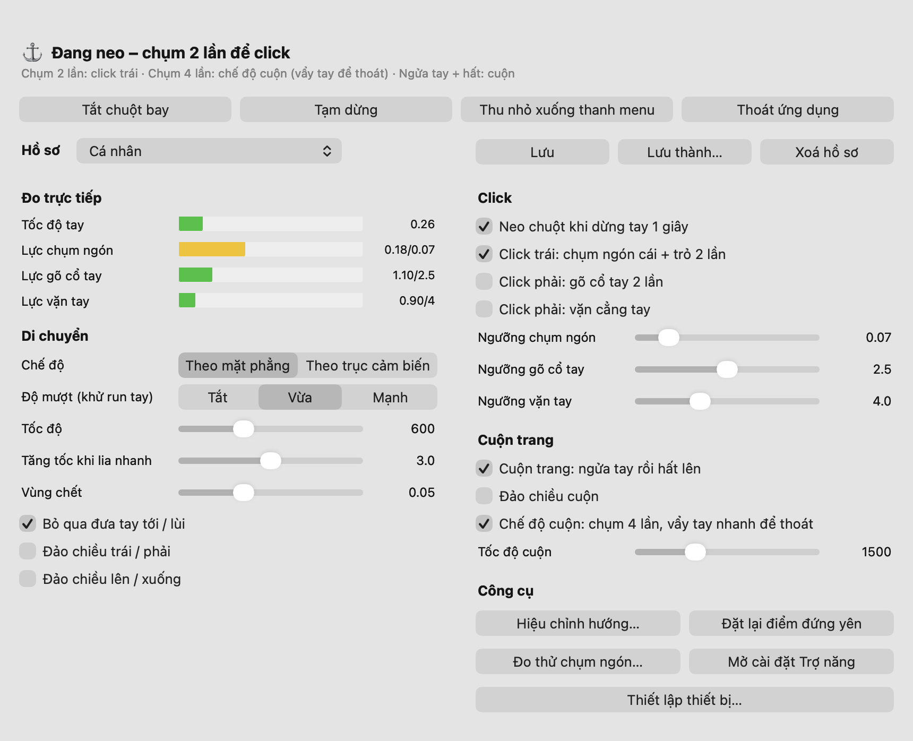

<p align="center"></p>

<h1 align="center">MiBand AirMouse</h1>

<p align="center">Biến vòng tay <b>Xiaomi Smart Band 10</b> thành chuột bay cho máy Mac.<br>
Lia cẳng tay để di chuyển con trỏ, chụm ngón tay để click, chụm bốn lần để cuộn trang.</p>

<p align="center"><a href="https://thanhhaiwork1998.github.io/miband-airmouse/"><b>📖 Hướng dẫn sử dụng có hình minh hoạ</b></a></p>

<p align="center"></p>

## Tính năng

| Cử chỉ | Tác dụng |
|---|---|
| Lia hoặc gạt cẳng tay | Di chuyển con trỏ (mượt, có tăng tốc khi lia nhanh) |
| Dừng tay một chút (mặc định 1 giây, chỉnh ở **Thời gian neo**) | Neo con trỏ tại chỗ |
| Chụm ngón cái vào ngón trỏ 2 lần | Click trái |
| Chụm 4 lần | Bật chế độ cuộn: nâng tay cao hơn lúc chụm thì trang tự cuộn lên, hạ tay thì tự cuộn xuống; lệch càng nhiều cuộn càng nhanh |
| Vẩy tay thật nhanh | Thoát chế độ cuộn |
| Lật ngửa tay rồi hất lên | Cuộn trang nhanh |
| Đưa tay tới hoặc kéo về | Được bỏ qua, con trỏ đứng yên |

**Chế độ điều khiển** (chọn ngay trên cửa sổ app):

| Cử chỉ | 🖱 Chuột | ▶️ Trình chiếu | 🎵 Media |
|---|---|---|---|
| Di tay | Di chuột | Di **chấm đỏ** (bút laser) | – |
| Chụm 2 lần | Click trái | Slide tiếp | Bật / tắt **núm âm lượng** |
| Xoay cổ tay (núm đang bật) | – | – | Tăng / giảm âm lượng |
| Chụm 3 lần | – | – | Phát / dừng |
| Lia nhanh sang phải / trái | Di chuột | Slide tiếp / trước | Bài sau / trước |
| Lia nhanh lên / xuống | Di chuột | – | Tăng / giảm âm lượng |

Ngoài ra:
- **Thiết lập lần đầu bằng mã QR**: quét bằng camera điện thoại (hoặc đăng nhập ngay trên Mac) vào tài khoản Xiaomi để app tự lấy token của vòng. Mật khẩu chỉ nhập trên trang của Xiaomi, app không thấy.
- **Cửa sổ điều khiển**: đo trực tiếp lực từng cử chỉ so với ngưỡng, **mô phỏng tư thế cánh tay** (nâng/hạ, trái/phải, xoay cổ tay, chuyển động), thanh trượt cho mọi thông số. App chạy nền; thanh menu chỉ có Tạm dừng và Thoát.
- **Độ trễ tự điều chỉnh** theo chất lượng Bluetooth (thường ~120 ms) để con trỏ phản hồi nhanh mà không giật.
- **Hồ sơ**: lưu bộ thông số và kết quả hiệu chỉnh cho từng người hoặc từng cách đeo.
- Biểu tượng riêng trên Dock.
- **Cập nhật một chạm**: khi có bản mới trên GitHub, app hiện "Có bản mới"; bấm **Cập nhật** là app tự tải, kiểm tra chữ ký, thay bản mới và mở lại, giữ nguyên quyền (bản dựng sẵn từ 1.6.0).

## Thiết bị hỗ trợ

| Thiết bị | Trạng thái |
|---|---|
| Xiaomi Smart Band 10 | ✅ Đã thử, chạy tốt |
| Xiaomi Smart Band 9 / 9 Pro / 9 Active | 🧪 Thử nghiệm (cùng họ giao thức, chưa thử trên thiết bị thật) |
| Mi Band 8 trở về trước | ❌ Chưa hỗ trợ (giao thức khác) |
| Apple Watch / Galaxy Watch | 🚧 Đang phát triển (`watch_source.py` mới có phần nhận dữ liệu trên Mac) |

## Cài đặt

### Cách 1: tải bản dựng sẵn (khuyên dùng)

1. Vào trang [**Releases**](https://github.com/thanhhaiwork1998/miband-airmouse/releases/latest) và tải:
   - `MiBand-AirMouse-…-arm64.zip` cho Mac chip Apple (M1 trở đi);
   - `MiBand-AirMouse-…-x86_64.zip` cho Mac chip Intel.
2. Giải nén, kéo **MiBand AirMouse** vào thư mục **Applications** rồi mở.
3. Lần đầu mở, macOS sẽ chặn vì app chưa được Apple xác minh (app miễn phí, không có chữ ký trả phí). Bấm **Done**, vào *System Settings → Privacy & Security*, kéo xuống và bấm **Open Anyway**. Chỉ cần làm một lần.

Bản dựng sẵn đã kèm Python và mọi thư viện, không cần cài thêm gì. Cài đặt của bạn được lưu ở `~/Library/Application Support/MiBand AirMouse/`.

**Nâng cấp:** từ bản 1.6.0, bấm **Cập nhật** trong app khi có bản mới, không cần làm gì thêm. Đang dùng bản cũ hơn thì tải tay bản mới một lần (thoát app, kéo bản mới vào Applications, chọn Thay thế) và bật lại quyền **Accessibility** lần cuối.

### Cách 2: chạy từ mã nguồn

Cần: macOS 12 trở lên và **Xcode** hoặc **Command Line Tools** (`xcode-select --install`), để có Python 3 và trình biên dịch `clang`.

```bash
git clone https://github.com/thanhhaiwork1998/miband-airmouse.git ~/airmouse
cd ~/airmouse
/usr/bin/python3 -m venv venv
venv/bin/pip install --upgrade pip
venv/bin/pip install -r requirements.txt
./build_app.sh
open /Applications/"MiBand AirMouse.app"
```

> **Phải clone vào đúng `~/airmouse`**: ứng dụng `MiBand AirMouse.app` khởi chạy mã nguồn từ thư mục này. Cài đặt được lưu ở `~/airmouse/config.json`.

Muốn tự đóng gói bản dựng sẵn: chạy `./build_release.sh` (arm64) hoặc `./build_release.sh x86_64`. Script tải một bản Python độc lập ([python-build-standalone](https://github.com/astral-sh/python-build-standalone)), kiểm tra mã SHA-256, rồi tạo file zip trong `dist/`.

### Lần đầu mở app


1. Cho phép **Bluetooth** khi macOS hỏi.
2. Bật **MiBand AirMouse** trong *System Settings → Privacy & Security → Accessibility* (để app được di chuột và click).
3. Màn hình **Thiết lập thiết bị** hiện ra: bấm **Quét mã QR…**, quét bằng camera điện thoại rồi đăng nhập tài khoản Xiaomi trên trang hiện ra (app Mi Fitness không quét được mã này). Tắt Bluetooth điện thoại, trên vòng mở **Tìm điện thoại**, bấm **Tìm vòng** rồi **Lưu và kết nối**.
4. Bấm **Hiệu chỉnh hướng…** một lần trong cửa sổ điều khiển.

Chi tiết từng bước và cách dùng cử chỉ có trong [hướng dẫn sử dụng](https://thanhhaiwork1998.github.io/miband-airmouse/).

> Mỗi lần chạy lại `build_app.sh` hoặc cài bản mới, macOS coi đó là app mới: hãy **tắt rồi bật lại** quyền Accessibility cho MiBand AirMouse.

**Tuỳ chọn**: nếu muốn lấy token bằng tài khoản + mật khẩu (trong Terminal) thay vì mã QR, cài thêm công cụ gốc:

```bash
git clone https://github.com/PiotrMachowski/Xiaomi-cloud-tokens-extractor.git ~/xiaomi-extractor
~/airmouse/venv/bin/pip install -r ~/xiaomi-extractor/requirements.txt
```

## Cách hoạt động

- **Kết nối**: Mac kết nối trực tiếp với vòng qua Bluetooth Low Energy (dịch vụ `fe95`, đặc tính `005e`/`005f`), xác thực bằng token của vòng và mã hoá AES theo giao thức "BLE V2" của Xiaomi. Vòng đã ghép với iPhone chỉ giữ kết nối khi máy kết nối tự giới thiệu là iPhone.
- **Cảm biến**: app mở một "buổi tập ẩn" trên vòng để vòng gửi gia tốc kế + con quay hồi chuyển khoảng 100 mẫu/giây (cách Gadgetbridge làm cho Sleep as Android). Vòng sẽ hiện màn hình tập luyện trong lúc dùng.
- **Di chuyển**: chuyển động được chiếu lên mặt phẳng ngang/đứng của căn phòng nhờ hướng trọng lực, nên lia cả tay hay chống khuỷu tay đều cho kết quả đúng hướng. Mỗi mẫu được phát lại đúng nhịp theo dấu thời gian của cảm biến (120 khung hình/giây), kèm bộ lọc khử run tay và tự sửa độ trôi của gyro.
- **Cử chỉ**: cú chụm ngón được nhận ra qua xung gyro rất ngắn mà vòng gần như không xoay, có bước xác nhận để tránh nhầm với lúc bắt đầu lia tay.

## Phát hành (dành cho người duy trì dự án)

Bản dựng sẵn được ký bằng chứng chỉ **"MiBand AirMouse"** (tự ký, tạo trong *Truy cập Chuỗi khoá → Trợ lý Chứng nhận → Tạo Chứng nhận…*, loại **Gốc tự ký / Ký mã**, để trống email). Các app đã cài chỉ nhận bản cập nhật ký bằng đúng chứng chỉ đó, và macOS nhờ nó mà giữ quyền qua các phiên bản, nên:

- `build_release.sh` từ chối đóng gói khi không có chứng chỉ này (`ADHOC=1` để thử nghiệm, bản đó không tự cập nhật được).
- **Sao lưu** chứng chỉ (xuất file .p12 có mật khẩu) và không bao giờ đưa nó lên GitHub. Mất chứng chỉ thì người dùng phải cài tay lại một lần.

Các bước: đổi số trong `version.py` → `./build_release.sh` và `./build_release.sh x86_64` → tạo release trên GitHub với hai file zip trong `dist/`.

## Cấu trúc mã nguồn

| File | Vai trò |
|---|---|
| `app.py` | Ứng dụng: xử lý cử chỉ, di chuột, menu, hồ sơ |
| `band.py` | Giao thức Bluetooth với Mi Band (xác thực, mã hoá, buổi tập ẩn) |
| `window.py` | Cửa sổ điều khiển |
| `laser.py` | Chấm đỏ của chế độ Trình chiếu |
| `arm_view.py` | Mô phỏng tư thế cánh tay trong cửa sổ điều khiển |
| `updates.py`, `version.py` | Kiểm tra bản mới trên GitHub; số phiên bản (script đóng gói đọc từ đây) |
| `installer.py` | Cập nhật một chạm: tải, kiểm tra chữ ký, thay app và mở lại |
| `setup_window.py`, `discovery.py`, `xiaomi_cloud.py` | Thiết lập lần đầu: quét vòng, đăng nhập Xiaomi bằng mã QR, lấy token |
| `launcher.m`, `build_app.sh`, `make_icon.py` | Đóng gói `MiBand AirMouse.app` có biểu tượng trên Dock |
| `build_release.sh` | Tạo bản dựng sẵn có kèm Python (zip để tải về) |
| `xproto/` | Mã Python sinh từ các định nghĩa protobuf của Gadgetbridge |
| `airmouse.py` | Công cụ dòng lệnh để chẩn đoán (`--probe`, `--diag`) |
| `watch_source.py` | Phần nhận dữ liệu từ Apple Watch (đang phát triển) |
| `docs/` | Trang hướng dẫn sử dụng (GitHub Pages) |

## Quyền riêng tư

- Token của vòng chỉ lưu trên máy bạn, trong `config.json` (bản dựng sẵn: `~/Library/Application Support/MiBand AirMouse/`, bản mã nguồn: `~/airmouse/`). Chỉ tài khoản của bạn đọc được file này, và nó nằm trong `.gitignore`. **Đừng chia sẻ nó.**
- Đăng nhập bằng mã QR đi thẳng tới máy chủ của Xiaomi; app không thấy và không lưu mật khẩu của bạn.
- Dữ liệu cảm biến chỉ được xử lý trên máy, không gửi đi đâu.

## Ghi công

- **[Gadgetbridge](https://codeberg.org/Freeyourgadget/Gadgetbridge)** (AGPL-3.0): giao thức Bluetooth của Xiaomi, cách xác thực và cách lấy cảm biến thô mà `band.py` chuyển thể sang Python, cùng các định nghĩa protobuf trong `xproto/`.
- **[Xiaomi-cloud-tokens-extractor](https://github.com/PiotrMachowski/Xiaomi-cloud-tokens-extractor)** của Piotr Machowski (MIT): phần đăng nhập bằng mã QR và gọi API trong `xiaomi_cloud.py`.
- [bleak](https://github.com/hbldh/bleak), [rumps](https://github.com/jaredks/rumps), [PyObjC](https://github.com/ronaldoussoren/pyobjc).

## Giấy phép

[GNU AGPL-3.0](LICENSE), vì một phần mã được chuyển thể từ Gadgetbridge.

Dự án cá nhân, không liên quan tới Xiaomi. Xiaomi, Mi Band và Mi Fitness là thương hiệu của Xiaomi. Bạn tự chịu trách nhiệm khi sử dụng.

---

### English

MiBand AirMouse turns a **Xiaomi Smart Band 10** into an air mouse for macOS: point with your forearm to move the cursor, double-pinch thumb and index finger to click, pinch four times to scroll. Presenter and media modes turn pinches and quick swipes into slide, playback and volume commands. It talks to the band directly over BLE (Xiaomi's encrypted "BLE V2" protocol, ported from Gadgetbridge) and streams the raw accelerometer/gyroscope through a hidden workout session. First-run setup fetches the band's auth key by QR login to your Xiaomi account. Download the prebuilt app (Python bundled; arm64 or x86_64) from [Releases](https://github.com/thanhhaiwork1998/miband-airmouse/releases/latest); on first launch allow it under System Settings → Privacy & Security → Open Anyway, since it is not notarized. Or run from source with the commands above (clone into `~/airmouse`). Licensed under AGPL-3.0.
